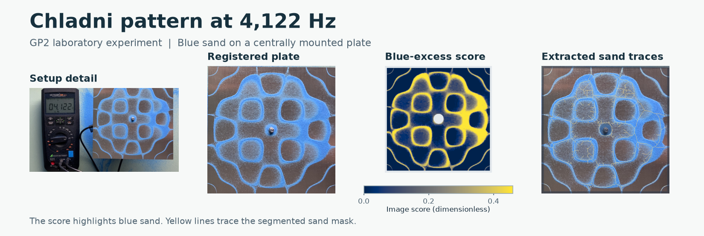
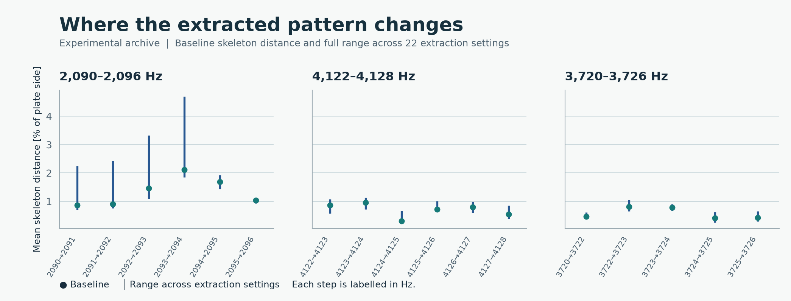
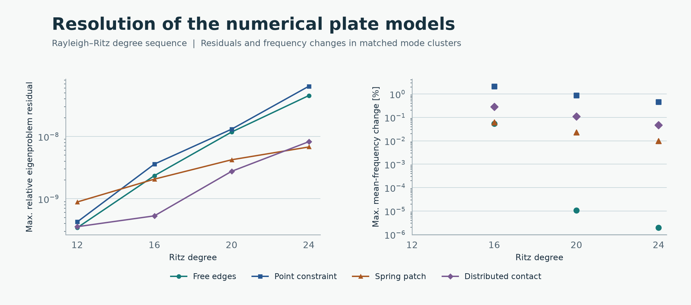
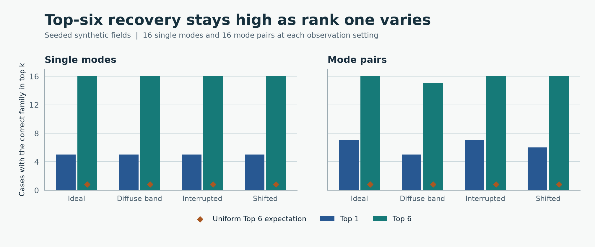
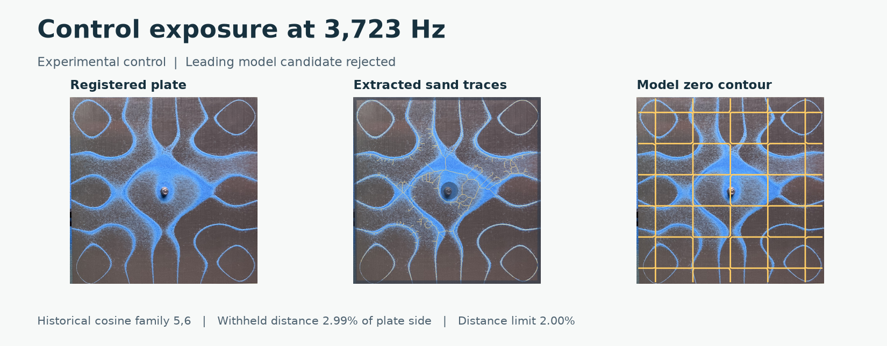
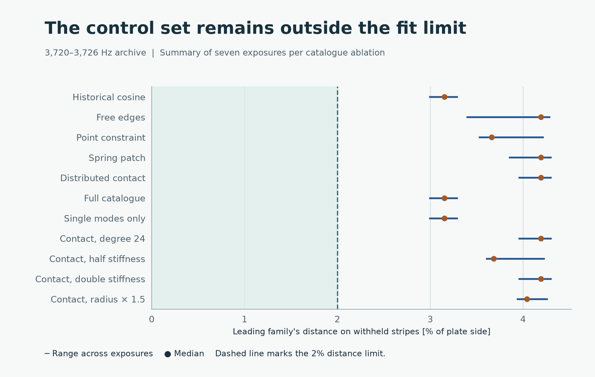

# Chladni Modal Analysis

Experimental pattern analysis, numerical plate mechanics, and inverse mode identification.



*GP2 experiment at 4,122 Hz. The heatmap shows the image segmentation score.*

**How reliably can a stationary sand pattern identify a vibrating plate's mode family?**

## Experimental Chladni Atlas

The strongest change between adjacent sand-line skeletons in the 2,090–2,096 Hz sweep occurs at **2,093 → 2,094 Hz** in all 22 extraction settings. The settings reprocess the same photographs. A mechanical resonance would require a measured frequency response. [Experimental results](dokumentation/V3_ERGEBNISSE.md)



## Numerical Plate Mechanics

Rayleigh–Ritz degree refinement reduces the frequency changes between matched mode clusters at different rates for different support models. The eigenproblem residuals measure how closely each computed solution satisfies its discrete equations. The real mounting remains uncharacterized. [Plate physics and solver benchmarks](dokumentation/PHYSIK.md)



## Inverse Mode Identification

For **32 ideal synthetic fields**, the known family appears in the **top six in 32/32** cases and **first in 12/32**. A uniform shortlist from 119 families would contain about 1.61 correct labels in total. These ranks describe simulated fields with known labels. [Inverse methods](dokumentation/V2_METHODEN.md) · [V3 test protocol](dokumentation/V3_PROTOKOLL.md)



## Model–Experiment Gap

**0 of 7** real control exposures meet the fixed acceptance rule. With the full catalogue, the leading families have distances of **2.99–3.30% of the plate side** on the withheld stripes, above the **2.00%** limit. The plot shows the range and median across the same exposures for each catalogue variant. The abstention result leaves the physical cause open. [Control study and limitations](dokumentation/V3_ERGEBNISSE.md)

At **3,723 Hz**, the leading candidate's zero contour misses much of the visible sand pattern. Its withheld distance is **2.99%**, so the rule rejects it.





## Reproduction and validation

With Python 3.12, run from the repository root in a fresh virtual environment.

```sh
python -m pip install -r requirements-lock.txt
python -m chladni.checks --scope all
python -m werkzeuge.v3_modellpaket
```

These commands regenerate the numerical and synthetic plots without archive data. The experimental panels use approved excerpts and derived views from two GP2 exposures. The sweep and gap plots summarize the private archive. The full experimental atlas and optional local Explorer require the private data and accompanying analysis files. [Figure provenance and reproduction](dokumentation/V3_REPRODUKTION.md) · [Release provenance](RELEASE_PROVENANCE.md)

## Scope, references and attribution

Independent human reference annotations remain pending. This independent student research and software project builds on a group experiment conducted during the undergraduate GP2 physics laboratory at Heinrich Heine University Düsseldorf. The project has no official HHU endorsement and has not undergone peer review. [References](dokumentation/PHYSIK.md) · [Licensing and attribution](LICENSING.md)
