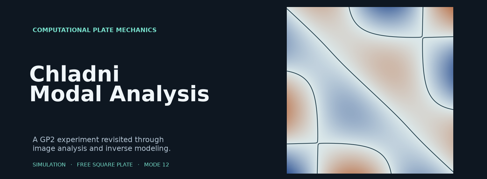

# Chladni Modal Analysis

Experimental pattern analysis, numerical plate mechanics, and inverse mode identification.



**How reliably can a stationary sand pattern identify a vibrating plate's mode family?**

| Evidence | Finding |
| --- | --- |
| **Experimental sweep** | The largest change between consecutive sand traces occurs at **2,093 → 2,094 Hz** in all 22 extraction settings. |
| **Synthetic benchmark** | The known family ranks in the top six for **32/32** ideal fields, versus **1.61 expected** with uniform selection from 119 families. Rank one is correct in **12/32** fields. The fixed rule accepts five cases, one with the wrong family. |
| **Experimental control** | **0/7** exposures at 3,720–3,726 Hz meet the fixed acceptance rule across the tested support and contact variants. |

## Experimental Chladni atlas

The local archive includes 168 full photographs across 24 series. The pipeline registers the plate, masks occlusions, and compares extracted sand traces across known excitation settings. The published aggregate findings are in the [V3 report](dokumentation/V3_ERGEBNISSE.md). Running the full atlas requires the private inputs listed in the [reproduction guide](dokumentation/V3_REPRODUKTION.md).

## Numerical plate mechanics

Rayleigh–Ritz models compare free edges, central constraints and distributed contact. The solver is checked against the analytic Navier spectrum and published free-plate benchmarks. Degree refinement tracks convergence, and projector overlap measures stability of near-degenerate subspaces. [Plate physics](dokumentation/PHYSIK.md)

## Inverse mode identification

Candidate families are ranked by geometry, with separate fit and check stripes. The decision rule can abstain. Among 1,438 distinct rasterized nodal masks, 62 are shared by more than one family. A static nodal set loses global sign and amplitude. [Methods](dokumentation/V2_METHODEN.md) · [V3 protocol](dokumentation/V3_PROTOKOLL.md)

## Reproduction and validation

With Python 3.12, run these commands from the repository root in a fresh virtual environment.

```sh
python -m pip install -r requirements-lock.txt
python -m chladni.checks --scope all
python -m chladni.forschung_v3 showcase
python -m werkzeuge.v3_modellpaket
```

These commands use synthetic inputs and versioned model settings. They run the scientific and software checks, regenerate the title image, and export the numerical convergence and seeded inverse benchmark figures. The local Explorer is optional. [Reproduction and figure exports](dokumentation/V3_REPRODUKTION.md) · [Release provenance](RELEASE_PROVENANCE.md)

## Scope, references and attribution

The photographs record sand geometry and excitation settings. Identifying mechanical resonances requires a measured frequency response. Independent human reference annotations remain pending.

This independent student research and software project builds on a group experiment conducted during the undergraduate GP2 physics laboratory at Heinrich Heine University Düsseldorf. The project has no official HHU endorsement and has not undergone peer review. [Physics and references](dokumentation/PHYSIK.md) · [Licensing and attribution](LICENSING.md)
